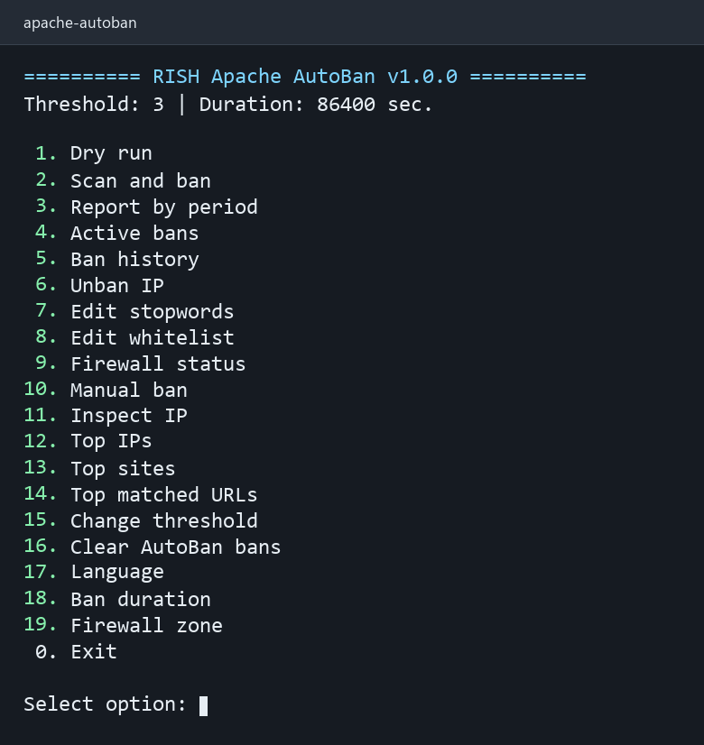
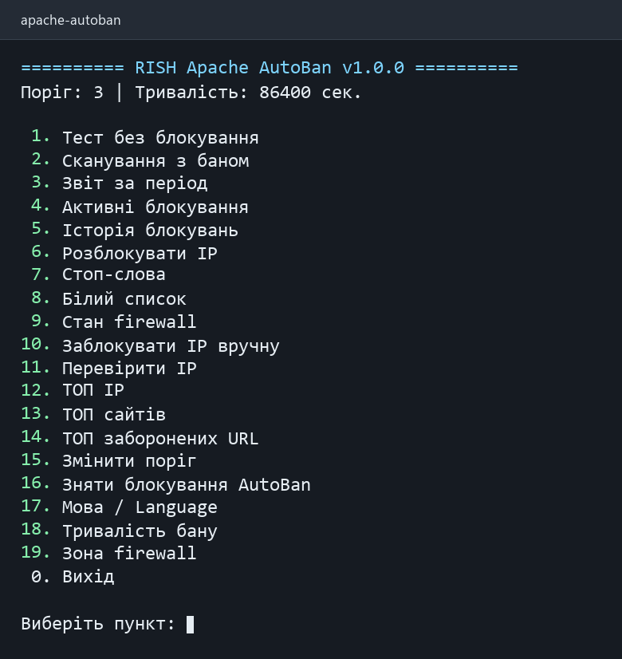
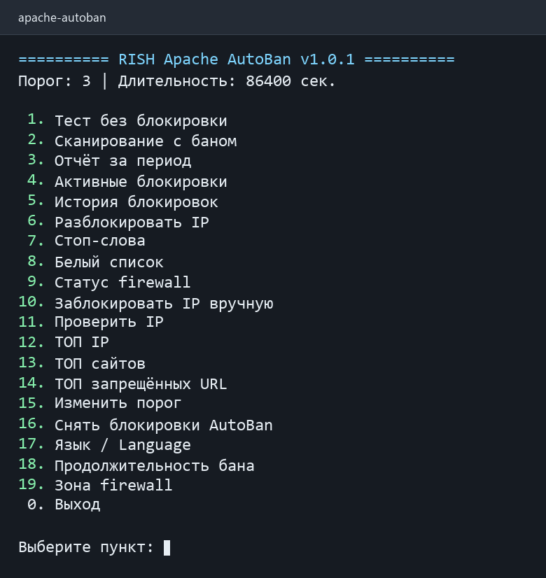

# Apache AutoBan для RISH

Версия 1.0.0

Apache AutoBan анализирует журналы доступа Apache, считает совпадения по IP и показывает адреса, которые достигли заданного порога. В режиме `--ban` утилита передаёт такие адреса в RISH для временной блокировки через firewalld.

- Поиск по настраиваемым подстрокам URL и белый список для IPv4, IPv6 и CIDR.
- Анализ текущих, ротированных и сжатых `.gz` журналов. Инкрементальный кэш для повторных сканирований фиксированного периода.
- Отчёты по IP, сайтам и URL, проверка отдельного IP и интерактивное меню на английском, украинском и русском.

## Требования

AutoBan рассчитан на штатную установку [RISH 2.10.3 и новее](https://github.com/Delo-Design/rish) с Apache и firewalld. Bash, Python 3, `flock` и `firewall-cmd` уже есть в этом окружении. Дополнительные системные пакеты и Python-библиотеки устанавливать не нужно.

Запускайте AutoBan от root для чтения журналов виртуальных хостов. Для применения блокировок нужен сеанс root по SSH. AutoBan использует модуль RISH `/root/rish/scripts/firewall_management.sh`.

## Установка

Выполните от root на сервере, где будет работать AutoBan:

```bash
git clone https://github.com/nevigen/rish-apach-autoban.git
cd rish-apach-autoban
bash install.sh
```

Если Git на сервере не используется, можно скачать и распаковать ZIP репозитория и запустить `bash install.sh` из распакованного каталога.

Установщик размещает файлы в `/opt/apache-autoban`, создаёт команду `apache-autoban` и добавляет конфигурацию ротации журнала действий. Существующие конфигурация, стоп-слова и белый список сохраняются.

## Настройка

Выберите нужные подстроки в `/root/apache-stopwords.txt`. В поставляемом файле все примеры закомментированы. Добавьте доверенные адреса и сети в `/root/apache-whitelist.txt`, по одному на строку. При сканировании также учитывается белый список RISH `/etc/firewalld/rish-whitelist.txt`, если он есть.

Основные параметры задаются в `/etc/apache-autoban/config.conf`. Переменные окружения имеют приоритет над этим файлом.

| Параметр | По умолчанию | Назначение |
| --- | --- | --- |
| `LOG_DIR` | `/var/www` | Корень поиска журналов доступа с именем `*-access-log` и поддерживаемых ротаций |
| `MIN_REQUESTS` | `3` | Минимум совпадений с подстроками URL для одного IP за выбранный период |
| `BAN_TIME` | `86400` | Срок блокировки в секундах, от 1 до 31 536 000 |
| `ZONE` | Пусто | Автовыбор единственной активной зоны firewalld. При нескольких зонах укажите нужную явно |
| `AUTOBAN_LANG` | `ru` | Язык интерфейса (`ru`, `uk`, `en`) |
| `BAN_LOG` | `/var/log/apache-autoban.log` | Журнал действий AutoBan |

## Использование

Сначала проверьте кандидатов без применения правил firewalld:

```bash
apache-autoban --dry-run --last 1h
apache-autoban --top-ip --last 1h
apache-autoban --top-sites --last 1h
apache-autoban --top-urls --last 1h
```

Чтобы открыть интерактивное меню, запустите `apache-autoban` без аргументов. Для периодических отчётов из cron используйте `--dry-run`. Этот режим может сохранять локальный кэш сканирования.

После проверки кандидатов можно применить временные блокировки из сеанса root по SSH:

```bash
apache-autoban --ban --last 1h
apache-autoban --list
```

После блокировки AutoBan сверяет запись в реестре RISH и наличие правила в firewalld. Совпадение URL со стоп-словом показывает причину попадания IP в отчёт. Оно само по себе не подтверждает атаку. Если Apache работает за обратным прокси, перед включением блокировок проверьте, что в поле адреса журнала записывается IP клиента.

## Снимки меню

### English



### Українська



### Русский


